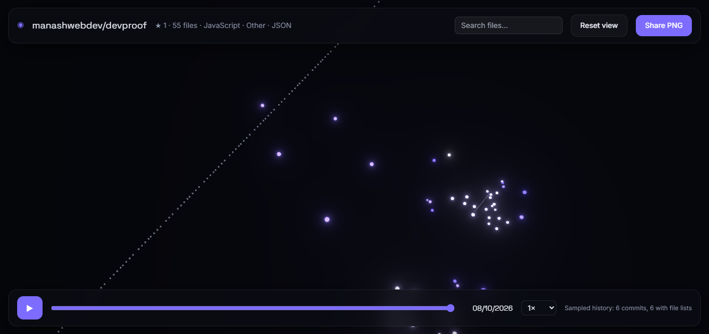

<div align="center">

# ✦ RepoCosmos

**Turn any public GitHub repository into an interactive 3D galaxy.**

Folders become star clusters. Files become stars. A time slider replays how the project grew.


<!-- Replace with your live link after deploying -->
[**Live Demo**](https://your-app.vercel.app) · [Report a Bug](../../issues) · [Request a Feature](../../issues)


</div>

---

## Screenshots

**Landing page** with the live demo galaxy and repo input


**Galaxy view** of a real repository, with search, time-slider dock and stats



---

## Features

- **3D galaxy view:** every file is a star, sized by file size, grouped into folder clusters. Layout is deterministic, so the same repo always looks the same.
- **Instanced rendering:** all stars are drawn in a single `InstancedMesh` with bloom, for smooth performance with up to 5,000 stars.
- **Inspect files:** hover for the path, click for size, language and the date it was added.
- **File search:** find any file by name without hunting for stars.
- **Time replay:** play, pause, scrub and change speed to watch the repo grow.
- **Share PNG:** download a snapshot of the current galaxy.
- **Secure by design:** GitHub token is used only in server-side route handlers and never reaches the browser.
- **Friendly errors:** invalid input, missing repos and GitHub rate limits are all handled in the UI.
- **Accessible:** keyboard shortcuts (`Space` play/pause, `Esc` close panel), visible focus rings, reduced-motion support.

## How it works

```
Browser ──► /api/repo?repo=owner/name ──► GitHub REST API
   │              (server, uses GITHUB_TOKEN, cached 1h)
   │                          │
   │      file tree + last 100 commits + file lists of newest 25
   ▼
d3-hierarchy pack ──► deterministic star positions
   ▼
React Three Fiber (InstancedMesh + Bloom) ──► interactive galaxy
```

1. Input is validated (accepts `owner/repo`, full URL, or `.git` suffix).
2. The server fetches the recursive file tree and recent commits, then returns a compact payload.
3. Files are packed into circles by folder, with a seeded Z offset for depth.
4. Language is inferred from the file extension and mapped to a shade of the single violet accent.

## Tech stack

Next.js (App Router) · TypeScript · Tailwind CSS · Three.js · React Three Fiber · Drei · Postprocessing · Framer Motion · Lenis · d3-hierarchy · Zod

## Getting started

**Requirements:** Node.js 18.18+ and a GitHub personal access token (no scopes needed for public repos).

```bash
# 1. Install dependencies
npm install

# 2. Add your token
cp .env.example .env.local
# then edit .env.local:
# GITHUB_TOKEN=ghp_your_token_here

# 3. Start the dev server
npm run dev
```

Open <http://localhost:3000> and try `pmndrs/zustand` or `facebook/react`.

### Scripts

| Command | Description |
| --- | --- |
| `npm run dev` | Start the development server |
| `npm run build` | Create a production build |
| `npm run start` | Run the production build |
| `npm run lint` | Lint the code |
| `npm run typecheck` | Run the TypeScript compiler without emitting |

## Project structure

```
src/
├── app/
│   ├── page.tsx                  # Landing page
│   ├── r/[owner]/[repo]/page.tsx # Galaxy page
│   └── api/repo/route.ts         # GitHub data route (server only)
├── components/                   # Landing, Galaxy (3D), RepoView (UI)
└── lib/
    ├── parse-repo-url.ts         # Input parsing and validation
    └── layout.ts                 # d3 layout, language map, size scaling
```

## Deployment (Vercel)

1. Push the project to GitHub (`.env.local` is git-ignored).
2. Import the repo at [vercel.com/new](https://vercel.com/new).
3. Add the environment variable `GITHUB_TOKEN`.
4. Deploy.

## Limitations

RepoCosmos is honest about what the GitHub API can provide:

- **Size is in bytes, not lines of code.** The Git Trees API does not return line counts.
- **History is sampled.** Only the newest 100 commit dates are read, and per-file history comes from the newest 25 commits. Older files appear at the start of the timeline.
- **Very large repos** may return a truncated file tree. The UI shows a notice when this happens.
- **Only public repositories** are supported.
- Stars are capped at 5,000 (the largest files are kept).
- The 3D page should be judged by frame rate, not Lighthouse score.

## Roadmap

- [ ] Commit orbit trails
- [ ] Camera fly-to on selection
- [ ] Folder nebula glows and labels
- [ ] Shareable `/r/owner/repo` links with dynamic OG image
- [ ] Contributors and commit list per file
- [ ] 2D fallback view for devices without WebGL
- [ ] Unit tests (Vitest), Playwright smoke test, GitHub Actions CI

## Contributing

Pull requests are welcome. Open an issue first to discuss larger changes.

## License

MIT © Manash Khati
